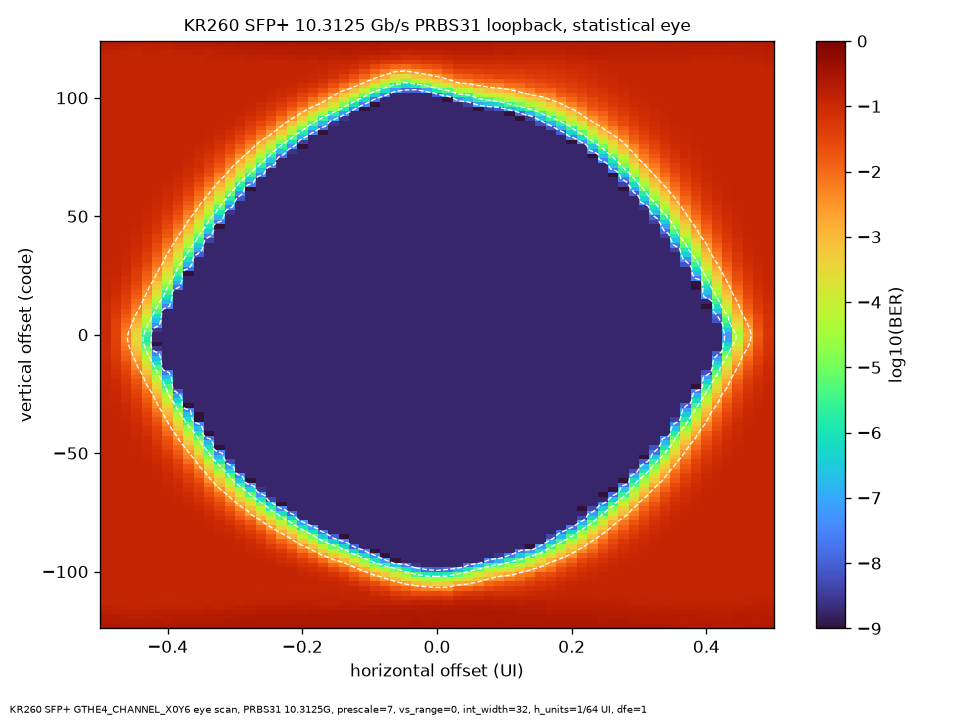

# KR260 acceptance test

Bring-up and acceptance testing of an AMD Kria **KR260 Robotics Starter Kit** (SK-KR260-G),
bought for learning high-speed serial design (10/25G Ethernet, GTH/GTY transceivers).

Everything here passed except the two PL-side GbE ports, which need a PL Ethernet design.
The test scripts and the FPGA tester were written with [Claude Code](https://claude.com/claude-code)
as part of an AI-assisted home lab.

| Item | Value |
|---|---|
| Carrier | SCK-KR-G rev B, serial XFL1AXCIQLR4, made 2026-07-17 |
| SOM | SMK-K26-XCL2G (xck26-sfvc784-2LV-c), serial XFL1Q4GYDJJI, 4 GB DDR4, 64 MB QSPI, **no eMMC** |
| Boot firmware | K26-BootFW-01.02 (QSPI image A and B both bootable) |
| OS | Ubuntu 24.04.2 LTS Server for Kria (`iot-limerick-kria-classic-server-2404-classic-24.04-x07-20250423`), kernel 6.8.0-1015-xilinx |
| Tools | Vivado 2026.1, **BASIC** (free) licence tier |

## Results

| # | Test | Status | Result |
|---|---|---|---|
| 1 | Visual inspection, SOM seated, fan | ✅ | Fan spins |
| 2 | Boot from SD to login | ✅ | Login prompt in under 60 s, no failed systemd units ([boot log](results/boot_console_20261118.txt)) |
| 3 | `xmutil boardid` / `bootfw_status` | ✅ | Both FRU EEPROMs read, both QSPI images bootable |
| 4 | Power, voltages, temperature (`xmutil xlnx_platformstats`) | ✅ | 3.1 W idle, PS 31 °C, PL 29 °C, all rails in range |
| 5 | Kernel log | ✅ | Only benign messages (TPM manual startup, dummy regulators, overlay warnings) |
| 6 | CPU / RAM | ✅ | 4× Cortex-A53 at 1333 MHz, 3.8 GiB usable |
| 7 | Thermal soak, 20 min `stress-ng` on all cores | ✅ | 4/4 passed, no throttling (25/25 samples at 1333 MHz), peak 4.67 W, PS 36 °C, PL 33 °C |
| 8 | `memtester 2500M 1` | ✅ | One full pass over 2.5 GB: all tests `ok`, 0 failures, exit 0 (53 min) |
| 9 | PS GbE port 1 (`eth1`) | ✅ | 1000/full; iperf3 multi-stream RX 942 Mb/s, TX 941 Mb/s, bidir 933/937 Mb/s, 0 NIC errors |
| 10 | PS GbE port 2 (`eth0`) | ✅ | 1000/full; iperf3 TX 941 Mb/s, RX 937 Mb/s (1 stream) / 942 Mb/s (4 streams), bidir 933/929 Mb/s, 0 NIC errors |
| 11 | PL GbE ports 3 + 4 | ⏸ | Need a PL design with the RGMII MACs |
| 12 | USB, all 4 ports | ✅ | Enumerated on `1-1.2`, `1-1.3`, `3-1.1`, `3-1.2` (USB 2 device, 18.9 MB/s read) |
| 13 | USB 3 (5 Gb/s) | ✅ | Kingston DataTraveler 3.0 enumerated at 5000M behind the USB5744 hub; 131 MB/s O_DIRECT read (above the ~40 MB/s USB 2 ceiling) |
| 14 | DisplayPort | ✅ | Monitor shows the boot console and login prompt |
| 15 | **SFP+ 10.3125 Gb/s, PRBS31 loopback** | ✅ | **3.09e12 bits, 0 errors → BER < 9.7e-13 (95 % confidence)** in the 5 min run ([log](results/sfp_prbs31_10g_20261119-0042.txt)); 1.27e13 bits, 0 errors (BER < 2.4e-13) while the eye scans ran; error injection 10/10 and 100/100 detected; measured line rate 10.3124 Gb/s |
| 16 | **SFP+ statistical eye (DRP eye scan)** | ✅ | **0.84 UI** horizontal opening and -98..+100 codes vertical, error-free at a 1.9e-9 floor ([plot](results/sfp_eyescan_10g_20261119.png), [data](results/sfp_eyescan_10g_20261119.csv)) |

On `eth1`, single-stream iperf3 RX reached only ~823 Mb/s and UDP RX dropped packets, while
`eth0` later did 937 Mb/s single-stream on an idle board: receive is limited by one A53 core,
not by the ports (both reach line rate multi-stream with zero errors).

## Repository layout

```
fpga/prbs_sfp/     SFP+ PRBS31 tester (free IP only) -- the one that works on BASIC
  rtl/             top level, AXI4-Lite register file, CDC synchroniser
  constraints/     pins + CDC constraints
  app/             Kria app: device-tree overlay, shell.json, board-side prbs.py
  build.tcl        Vivado batch build -> out/kr260-prbs.bit.bin
  deploy.sh        copy + install the app on the board
  plot_eye.py      eye-scan CSV -> log10(BER) heatmap (PC side)
fpga/ibert_sfp/    IBERT version (needs a CORE/PRO licence: BASIC refuses to synthesise IBERT)
linux/soak.sh      thermal + memory soak, run on the board
results/           logs from the runs above
```

## Board access

The board is on a direct link to the PC's USB 2.5 GbE adapter (`enp0s20f0u3`), which runs a
NetworkManager "shared" profile `kr260`: the PC is `10.42.0.1` and hands out `10.42.0.x` by DHCP
with NAT to the internet. Find the board with `ip neigh show dev enp0s20f0u3`.

Serial console: micro-USB J4 enumerates as 4 FTDI ports; the Linux console is `/dev/ttyUSB1`
at 115200 8N1 (`ttyUSB0` is JTAG).

The board has no power switch: run `sudo poweroff`, wait for `reboot: Power down` on the
console (or the PL heartbeat LED to stop), then unplug the 12 V supply. The fan may speed up
after Linux halts; that is normal.

## SFP+ PRBS tester

Vivado 2026.1 BASIC will not build IBERT
(`[Chipscope 16-620] ... Your current selected license is BASIC`), so this design uses only
free IP and the transceiver's own PRBS logic:

- **GT Wizard 1.7** drives `GTHE4_CHANNEL_X0Y6` (quad 224 lane 2, the SFP+ cage) at
  10.3125 Gb/s raw, QPLL0, from the U90 fixed 156.25 MHz oscillator on MGTREFCLK0_224 (Y6/Y5).
- The GTH's built-in **PRBS-31 generator** (TXPRBSSEL) and **checker** (RXPRBSSEL,
  RXPRBSERR, RXPRBSLOCKED) do the work; TXPRBSFORCEERR injects errors to prove the checker counts.
- Counters run on the RX user clock (161.13 MHz = 10.3125 G / 64). Linux reads them through an
  AXI4-Lite register file on HPM0_FPD at `0xA000_0000`. The Kria boot firmware sets HPM0_FPD
  to 128 bits (`AFI_FS = 0xA00`), so the block design matches that.
- Loaded as a Kria app (`xmutil loadapp kr260-prbs`) so the FPGA manager configures the PL
  and the PS-PL interface properly.
- SFP LEDs: one = checker locked, other = error seen since clear. User LEDs: heartbeat and
  transceiver reset done.
- The channel DRP is bridged to the register file, so Linux can read/write any GTHE4
  attribute and run the transceiver's eye-scan engine (see below).
- Uses under 1 % of the PL logic and 1 of 4 GTH channels; timing met (WNS +2.2 ns, WHS +0.03 ns).

Pins come from [fpganinja/taxi](https://github.com/fpganinja/taxi/tree/main/src/eth/example/KR260/fpga)
and [litex-boards](https://github.com/litex-hub/litex-boards/blob/master/litex_boards/platforms/xilinx_kr260.py),
cross-checked against the package (R4/T2 → `GTHE4_CHANNEL_X0Y6`, Y6 → `GTHE4_COMMON_X0Y1`).

### Run it

```bash
# PC
vivado -mode batch -source fpga/prbs_sfp/build.tcl
KR260_SUDO_PW=... KR260_SSH_KEY=~/.ssh/<key> fpga/prbs_sfp/deploy.sh ubuntu@10.42.0.79

# Board (SFP+ loopback module inserted)
sudo xmutil unloadapp
sudo xmutil loadapp kr260-prbs
sudo prbs.py status        # lock + counters
sudo prbs.py inject 10     # proves the checker counts (expect 2 error cycles per injection)
sudo prbs.py run 300       # 5 min soak: 0 errors over ~3.1e12 bits => BER < 1e-12
sudo prbs.py eyescan /tmp/eye.csv 1 2 7 0   # fine 2D eye, ~9 min (2 4 5 0 = quick, ~40 s)

# PC
scp ubuntu@10.42.0.79:/tmp/eye.csv results/ && fpga/prbs_sfp/plot_eye.py results/eye.csv
```

Each injected bit error shows up as 2 error cycles: PRBS-31 (x^31 + x^28 + 1) is
self-synchronising, so one flipped bit is seen where it lands and again when it feeds the
taps 28 and 31 bits later, which usually falls in the next 64-bit word.

### Register map (`0xA000_0000`)

| Offset | Name | Access | Description |
|---|---|---|---|
| 0x00 | ID | RO | `0x50524253` ("PRBS") |
| 0x04 | VERSION | RO | `0x00020000` |
| 0x08 | CTRL | RW | [0] GT reset, [1] clear counters + checker, [2] inject toggle, [3] snapshot toggle, [4] EYESCANRESET |
| 0x0C | STATUS | RO | [0] gtpowergood [1] tx_done [2] rx_done [3] prbs_locked [4] error_seen [5] snap_ack [6] rx_cdr_stable [7] userclk_tx [8] userclk_rx |
| 0x10/0x14 | LOCKED_LO/HI | RO | RX user-clock cycles while locked (× 64 = bits checked) |
| 0x18 | ERR_CYCLES | RO | cycles with RXPRBSERR set |
| 0x1C | INJECTED | RO | errors injected on TX |
| 0x20 | DRP_CMD | WO | start a DRP access: [9:0] address, [31] 1 = write |
| 0x24 | DRP_WDATA | RW | [15:0] data for the next DRP write |
| 0x28 | DRP_STATUS | RO | [0] busy, [1] timeout, [31:16] last read data |

Counters are snapshotted: flip CTRL[3], wait until STATUS[5] matches, then read.

### Eye scan without IBERT



The GTHE4 has a second, offset sampler for margin analysis. `prbs.py eyescan` drives it over
DRP, following the procedure in corundum's `utils/xcvr_gthe4.c` (register addresses from
corundum's `include/gt/gthe4_regs.h`; the DRP path is self-checked by decoding
RX_DATA_WIDTH/RX_INT_DATAWIDTH back to 64/32):

1. `ES_ERRDET_EN = 1`, all `ES_QUAL_MASK` = 0xFFFF, `ES_SDATA_MASK` set for the 32-bit
   internal width, `ES_EYE_SCAN_EN = 1`.
2. Alignment check at the centre (BER must be < 1 %, otherwise pulse EYESCANRESET).
3. For every point: `ES_HORZ_OFFSET` (1/64 UI at full rate, ±32 = ±0.5 UI),
   `RX_EYESCAN_VS_CODE`/`NEG_DIR`, set `ES_CONTROL = 1`, poll `ES_CONTROL_STATUS[0]`, read
   `ES_ERROR_COUNT` and `ES_SAMPLE_COUNT`; bits = samples × 32 × 2^(1+prescale).
4. The GT Wizard ties RXLPMEN = 0 (DFE), so each point is measured with `UT_SIGN` 0 and 1.
   Each half only samples its own data condition, so the point's BER is the **average** of the
   two half BERs. Summing the counts instead produces a fake low-BER plateau above and below
   the eye, where one half is open and the other saturates at 65535 errors almost at once.

The fine scan (65 × 125 points, prescale 7) takes about 9 minutes. The PRBS link keeps
running during the scan (the offset sampler is separate from the data sampler).

## Next steps

- PL GbE ports 3 + 4 via a PL RGMII design (e.g. the
  [taxi KR260 example](https://github.com/fpganinja/taxi/tree/main/src/eth/example/KR260))
- 10GBASE-R PCS/MAC on the SFP+ and a link to the ConnectX-4 Lx over the 10G DAC
